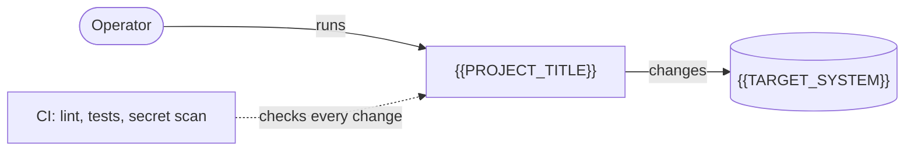

<!-- header:begin: the project page on luminare.tech drops this block, because the page has its own heading -->
<picture>
  <source media="(prefers-color-scheme: dark)" srcset="docs/brand/readme-header-dark.svg">
  <source media="(prefers-color-scheme: light)" srcset="docs/brand/readme-header-light.svg">
  
</picture>

<!-- byline:studio -->
*a [Luminare Development](https://luminare.tech/open-source/{{SLUG}}/) open-source project*
<!-- /byline:studio -->
<!-- byline:personal
*by {{AUTHOR_NAME}} · [project page](https://luminare.tech/open-source/{{SLUG}}/)*
/byline:personal -->
<!-- header:end -->

<!-- template-only:begin -->
> [!NOTE]
> **This repository is a template.** Every open-source repository of the
> [luminare-dev](https://github.com/luminare-dev) organization starts from it: README skeleton,
> NOTICE, docs skeleton, licence texts, pinned CI, secret scanning, OpenSSF Scorecard and release
> automation with checksums and build provenance. Create a repository with **Use this template**,
> then follow [PUBLISHING.md](PUBLISHING.md), part A. Values in double curly braces are
> placeholders listed in [PLACEHOLDERS.md](PLACEHOLDERS.md); CI fails until each one is filled.
> Delete this note, with its two marker comments, in the new repository.
<!-- template-only:end -->

# {{PROJECT_TITLE}}

{{ONE_LINE_PURPOSE}}

[](https://github.com/luminare-dev/{{SLUG}}/actions/workflows/ci.yml)
[](https://github.com/luminare-dev/{{SLUG}}/releases)
[](LICENSE)
[](https://scorecard.dev/viewer/?uri=github.com/luminare-dev/{{SLUG}})

<!-- template: GIF slot. Record a short GIF (or a screenshot) in your own lab: no player data, no
     hostnames or IP addresses, no game art. Save it as docs/media/demo.gif and replace this
     comment with the line below. Delete the comment if there is nothing to show.
      -->

## Why

{{PROBLEM_STATEMENT}}

<!-- template: 2-4 sentences. Who runs into the problem, what this project does about it, and what
     it shows in words a reader searches for (for example "Ansible collection with Molecule-tested,
     idempotent roles"). Facts only; every claim must be reproducible from this repository. -->

## Quickstart

```bash
{{QUICKSTART_COMMANDS}}
```

<!-- template: at most 5 commands, copy-paste ready, tested on a clean machine. Longer setups go
     to docs/install.md. -->

## How it works



<!-- template: replace the diagram with the real flow (5-9 boxes). GitHub renders Mermaid; the
     project page turns it into a static SVG. -->

## Design decisions

The decisions behind this project are recorded as short ADRs in [docs/adr/](docs/adr/):

- [ADR 0001: Record architecture decisions](docs/adr/0001-record-architecture-decisions.md)
- [ADR 0002: Pin every action and downloaded tool](docs/adr/0002-pin-actions-and-downloaded-tools.md)
- [ADR 0003: Secret scanning with the gitleaks binary](docs/adr/0003-secret-scanning-with-the-gitleaks-binary.md)
- [ADR 0004: Draft releases with checksums and provenance](docs/adr/0004-draft-releases-with-checksums-and-provenance.md)

<!-- template: ADRs 0001-0004 come with the template and describe its CI and release design.
     Add the project's own decisions from 0005 on, one line each ("Why X instead of Y"). Add an
     "Alternatives" paragraph when similar projects exist: what they do well and why this project
     differs. Stay factual and friendly; never belittle another project. -->

## Supported versions

| Component | Tested with | Supported |
|---|---|---|
| {{COMPONENT}} | {{TESTED_VERSION}} | {{SUPPORTED_RANGE}} |

Fixes go into the latest minor release only. See the
[security policy](https://github.com/luminare-dev/.github/blob/main/SECURITY.md) for reporting.

## Limitations

- {{LIMITATION}}

<!-- template: what it does not do, known rough edges, and what it was never tested on. -->

## Results

| What | Value | How it was measured |
|---|---|---|
| {{RESULT}} | {{VALUE}} | {{METHOD}} |

<!-- template: honest numbers with their method and date (run time, idempotence "changed=0",
     test count, alert rules tested). No numbers you cannot reproduce. -->

## Documentation and links

- [Installation](docs/install.md) · [Configuration](docs/configuration.md) ·
  [Upgrade](docs/upgrade.md) · [Troubleshooting](docs/troubleshooting.md) ·
  [Runbook](docs/runbook.md) · [ADRs](docs/adr/)
- [Changelog](CHANGELOG.md) and [releases](https://github.com/luminare-dev/{{SLUG}}/releases)
  (each release has `SHA256SUMS` and a build provenance attestation)
- [Contributing](https://github.com/luminare-dev/.github/blob/main/CONTRIBUTING.md) ·
  [Code of conduct](https://github.com/luminare-dev/.github/blob/main/CODE_OF_CONDUCT.md) ·
  [Security](https://github.com/luminare-dev/.github/blob/main/SECURITY.md) ·
  [Support](https://github.com/luminare-dev/.github/blob/main/SUPPORT.md)
- Project page: <https://luminare.tech/open-source/{{SLUG}}/>

<!-- fxserver:begin -->
## Not affiliated

Not affiliated with or endorsed by Cfx.re, Rockstar Games or Take-Two. FiveM, RedM and FXServer
are named only to describe what this project works with.

<!-- template: keep this section only for projects that work with FiveM or RedM servers
     (FXServer); otherwise delete it from fxserver:begin to fxserver:end. Platform names go in the
     description and topics, never in the project name. -->
<!-- fxserver:end -->

## Licence

[{{SPDX_ID}}](LICENSE). The licence covers the code only: the project name, logo, header images
and `docs/brand/` are not licensed (see [NOTICE](NOTICE)).

<!-- byline:studio -->
*a [Luminare Development](https://luminare.tech/open-source/{{SLUG}}/) open-source project*
<!-- /byline:studio -->
<!-- byline:personal
*by {{AUTHOR_NAME}} · [project page](https://luminare.tech/open-source/{{SLUG}}/)*
/byline:personal -->
